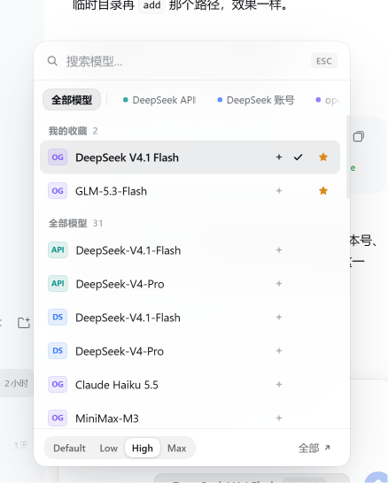
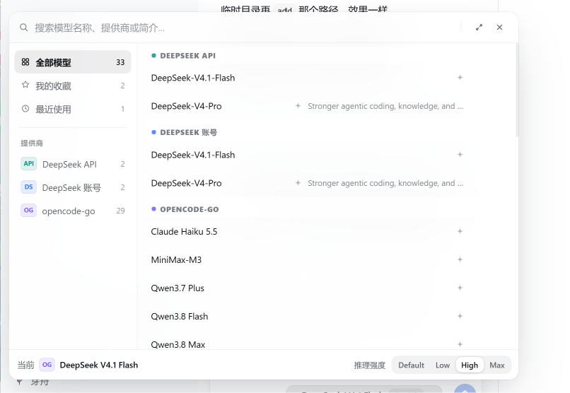
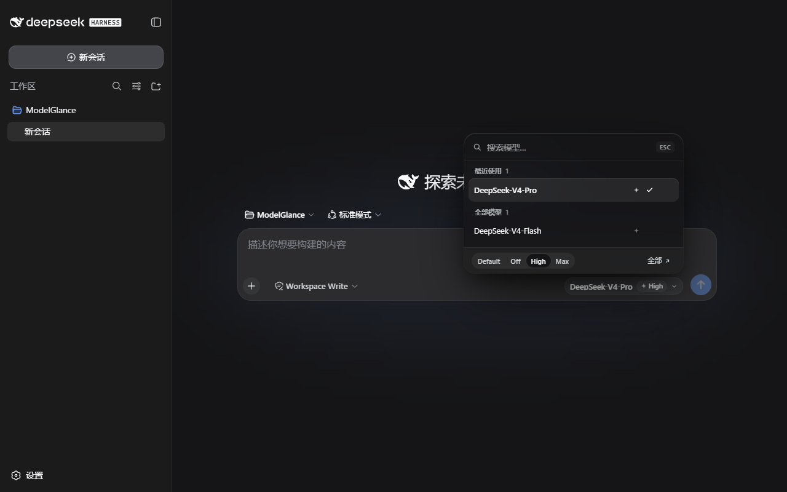
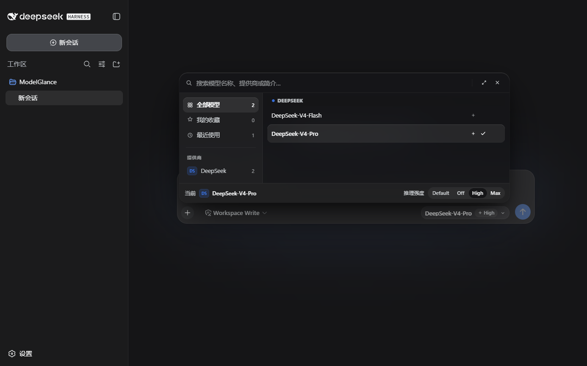

# ModelGlance

<p align="left">
  <strong>English</strong> &nbsp;|&nbsp; <a href="README.zh-CN.md">简体中文</a>
</p>

**A refined, Apple / Arc inspired model picker for DeepSeek Harness.**

ModelGlance replaces the small model button in the composer with a frosted liquid-glass,
two-mode picker: a compact popover for everyday switching, and an integrated Command Bar
panel with a provider sidebar for browsing. It is a thin skin over the model selection DSH
already ships — it reads the host's model catalog and asks the host to switch. It never
stores credentials, never talks to the network, and never touches your provider configuration.

## Preview

<p align="center">
  <br>
  <sub><b>Compact Popover (Light)</b> — Pinned "All" chip + horizontally scrollable provider rail, curated brand color badges, and unified effort dock.</sub>
</p>

<p align="center">
  <br>
  <sub><b>Expanded Panel (Light)</b> — Integrated top Command Bar, color-coded provider sidebar, and continuous model list.</sub>
</p>

<p align="center">
  <br>
  <sub><b>Compact Popover (Dark)</b> — Frosted liquid-glass surface with sliding reasoning effort pill, automatically following DSH's dark theme.</sub>
</p>

<p align="center">
  <br>
  <sub><b>Expanded Panel (Dark)</b> — Two-pane frosted layout with monochrome chrome and restrained brand accents.</sub>
</p>

> Screenshots show the plugin running in DeepSeek Harness. Providers and models come strictly
> from your live DSH session — unconfigured providers are never shown.

## Why

The stock composer control is deliberately minimal: a name, a chevron, maybe an effort
badge. That works until you have a dozen models across three providers, a couple of
favourites, and you keep forgetting which one supports reasoning. ModelGlance adds
structure — search, providers, favourites, recents, real effort levels — without turning
model choice into a management console.

## Features

- **Apple / Arc liquid-glass UI.** Frosted translucent surface, unified bottom dock in the
  compact popover, and an integrated Command Bar header in the expanded panel.
- **Pinned horizontal provider rail.** When multiple providers are configured, "All" stays
  pinned on the left while providers scroll smoothly horizontally (including mouse wheel
  scroll) with soft edge fade masks. Automatically hidden when only one provider is active.
- **Curated brand color badges.** Built-in restrained tonal colors & monograms for 30+
  model providers and aggregators (DeepSeek Account vs. DeepSeek API, OpenCode Go,
  OpenDesign Go, Command Code Go / GOAT, OpenRouter, SiliconFlow, Anthropic, OpenAI,
  Gemini, GLM, Qwen, Kimi, MiniMax, Ollama, etc.), plus a deterministic 10-color fallback
  palette for any custom third-party provider.
- **Search, favourites and recents.** Case-insensitive search across name, id, provider and
  description. Favourites and recents are stored locally as `<provider>/<model>` ids only.
- **Only real effort levels.** The host decides which reasoning efforts a model advertises,
  rendered with a smooth sliding pill control. When a model has no reasoning metadata, the
  effort control is hidden — ModelGlance never invents a level.
- **Follows your theme.** Every surface colour derives from DSH `--dsw-alias-*` tokens via
  `color-mix()`, automatically syncing with the host's light/dark appearance.
- **Keyboard.** `↑`/`↓` to move (with auto-scroll into view), `Enter` to switch, `Esc` to
  close and return focus, `→`/`←` to toggle between compact and expanded modes. No global
  shortcuts are registered.
- **Honest about failure.** A rejected switch keeps the previous model, keeps the panel
  open, and shows the host's error. A successful switch closes the compact popover and keeps
  the expanded panel open.

## Install

Requires **DSH 0.2.3-alpha.2 or later**, plus `git` on your PATH. Verified only on
`0.2.3-alpha.2` — this is an alpha host, and slot contracts can change between releases.

### Straight from this repository — one command

```sh
dsh plugin --profile desktop add https://github.com/DavidLiu12-code/dsh-model-glance.git
```

That is the whole install. Hand the repository URL and that command to an agent and it can
do it; nothing else is needed. pnpm clones the repository into your profile, the package's
`cordis.patch.yml` adds the plugin to the bundle, and it activates on the next start. There
is no build step and no dependency install — the client half is plain JavaScript that
borrows React from the host at runtime.

Then **fully quit and reopen DSH**. A new conversation shows the new control in the
composer.

To update, run the same command again (it re-resolves the default branch and records the
new commit). If your network needs a proxy, `dsh plugin` inherits `HTTP_PROXY` /
`HTTPS_PROXY` from the shell you run it in.

### From a local checkout

```sh
git clone https://github.com/DavidLiu12-code/dsh-model-glance.git
dsh plugin --profile desktop add /absolute/path/to/dsh-model-glance
```

To remove it:

```sh
dsh plugin --profile desktop remove dsh-model-glance
```

Nothing else is modified: the plugin keeps no files outside its own package, adds one
dependency line to the profile manifest, and a junction (or `node_modules` link) that the
removal deletes with it.

### Manual install (advanced, not recommended)

If `dsh plugin add` cannot run in your profile (for example because an unrelated package in
that profile references a missing local tarball), the same effect can be produced by hand —
`dsh.profile.bundles` in the profile's `package.json`, a `link:` dependency, and a
directory junction in the profile's `node_modules`. ModelGlance itself needs none of this
special handling; the fallback exists because the plugin loader runs in the profile's pnpm
workspace. Back up the profile first if you go this route.

## How it works

ModelGlance registers the `conversation.input.model` slot with `priority: -1`. A single
slot renders its lowest-priority entry, so this shadows the built-in control
deterministically rather than depending on registration order. It then uses the injected
seat face — `directory` (a snapshot store), `load()`, and `select()` — which is the same
per-session directory the built-in `/model` dialog uses. `select()` resolving to a
non-`ok` result, or rejecting, is a failure; anything else is a success. No optimistic
update is ever rendered.

If another plugin already occupies that slot, ModelGlance **does not register at all**: it
logs one warning and leaves the seat alone. It never disables, reorders or unloads anything
else.

## Safety

The plugin runs with no host capabilities beyond the UI slot:

- no filesystem access, no shell, no child processes;
- no network requests of any kind, no telemetry, no auto-update, no remote code;
- no reading of credentials, API keys, base URLs or provider configuration;
- no writing to host state — the only persistent data is favourites and recents in the
  host page's `localStorage`;
- one dependency line and one link in your profile, both removed by uninstalling.

Installing a plugin does write to your profile directory. It is not a zero-risk operation,
and this README will not claim otherwise.

## Known limitations

- Only the composer seat is skinned; the `/model` dialog is untouched.
- Third-party `conversation.input.model.label` badges are not rendered by this picker.
- Context window, input modalities and pricing are **not** shown, because the browser-side
  catalog does not carry them. Displaying them would require a new network route, which
  this plugin refuses to add.
- Host-specific tooltip and option rows are not reproduced.
- Subagent conversations expose no model picker in DSH, so neither does this.
- Not yet tested with very large catalogs (100+ providers), multiple monitors, or with
  other plugins that also decorate the composer.

## Development

The client half is a single hand-written `client.js` — no bundler, no runtime dependency.
React and `react-dom` come from the host's module table at runtime.

```sh
node tests/smoke.mjs          # offscreen: fake host, real SSR render, no app needed
```

The browser suites drive an isolated DSH profile (never your real one):

```sh
# terminal 1 — isolated profile listening on 5199
set DSH_HOME=D:\path\to\.test-home
dsh --profile modelglance-test --port 5199

# terminal 2
set MG_APP_URL=http://127.0.0.1:5199
node tests/e2e.mjs            # behaviour + layout at 100/125/150% and 720px
node tests/failure.mjs        # rejected switches, IME Enter
node tests/catalog.mjs        # injected 30-model catalog, truncation, scrolling
```

See [`tests/README.md`](tests/README.md) for what each suite proves and which env vars it
needs.

`design/` holds the HTML visual reference the plugin's CSS was derived from. It is a
specimen, not part of the runtime bundle.

## Compatibility

| DSH | Status |
| --- | --- |
| 0.2.3-alpha.2 | tested (smoke 4/4, e2e 30/30, failure 8/8, catalog 14/14) |
| other versions | **unverified** |

## License

MIT — see [LICENSE](LICENSE).
