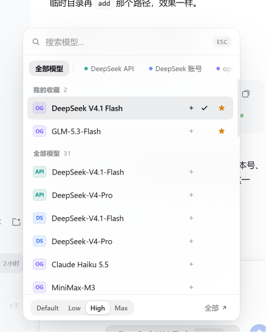
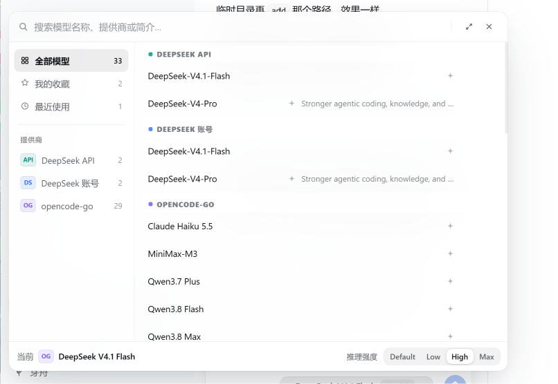
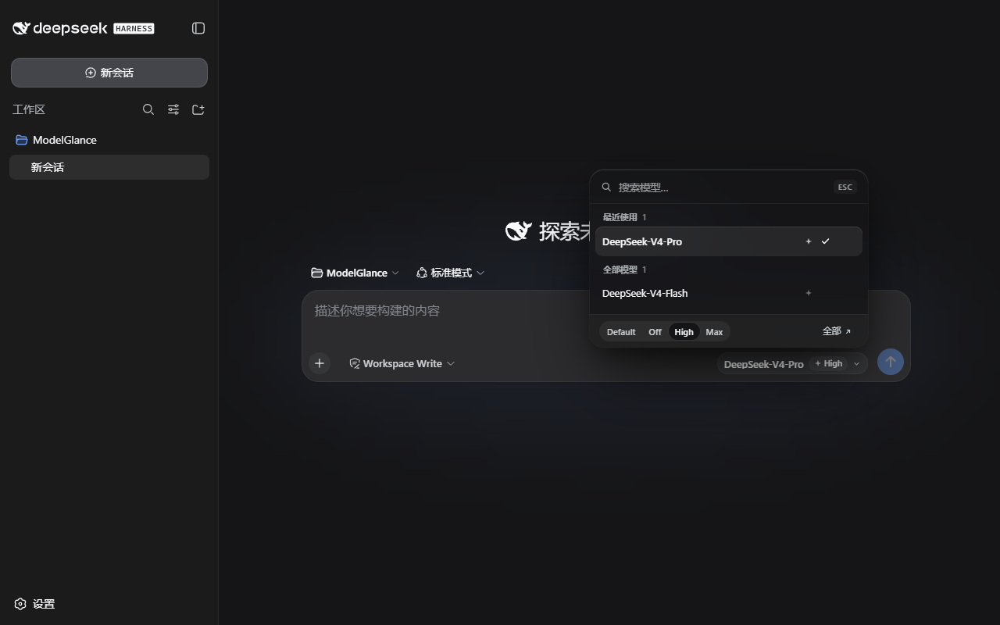
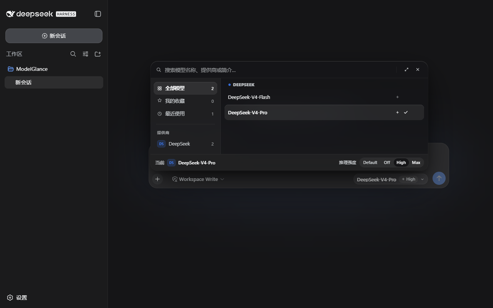

# ModelGlance

<p align="left">
  <a href="README.md">English</a> &nbsp;|&nbsp; <strong>简体中文</strong>
</p>

**一个 Apple / Arc 液态毛玻璃风格的 DeepSeek Harness 轻量模型选择器。**

ModelGlance 把输入框里的小模型按钮换成一个两段式液态毛玻璃选择器：日常切换用紧凑弹窗，浏览全部模型用带左侧提供商导航与顶部一体化 Command Bar 的展开面板。它只是 DSH 已有模型选择机制的一层轻量皮肤 —— 只读宿主模型目录、请宿主切换模型；不保存任何凭据、不发任何网络请求、不碰你的提供商配置。

## 界面预览

<p align="center">
  <br>
  <sub><b>紧凑弹窗（浅色）</b> —— 左侧固定「全部模型」+ 右侧滚轮横向滚动提供商栏、厂商专属色徽标与底部合一推理滑块。</sub>
</p>

<p align="center">
  <br>
  <sub><b>展开面板（浅色）</b> —— 顶部一体化搜索 Command Bar、左侧专属色提供商导航与右侧连续模型列表。</sub>
</p>

<p align="center">
  <br>
  <sub><b>紧凑弹窗（深色）</b> —— 液态毛玻璃质感与全胶囊推理滑块，自动跟随 DSH 深色外观。</sub>
</p>

<p align="center">
  <br>
  <sub><b>展开面板（深色）</b> —— 深色双栏磨砂布局，克制耐看、无视觉噪音。</sub>
</p>

> 截图为插件在 DeepSeek Harness 中的实际运行效果。所有提供商与模型均严格来自当前会话真实配置，未订阅的厂商绝不会出现。

## 为什么做它

宿主自带的控件刻意做得极简：一个名字、一个箭头、也许一个推理档位角标。模型只有两三个时够用；一旦变成三个提供商、十几个模型、几个收藏，再加上「哪个支持推理」记不清，就不够用了。ModelGlance 补的是结构 —— 搜索、提供商、收藏、最近使用、真实档位 —— 而不是把选模型变成一套管理后台。

## 功能

- **Apple / Arc 液态毛玻璃界面**：大圆角半透明毛玻璃容器、紧凑弹窗底部合一 Dock、展开面板顶部一体化搜索 Command Bar，未收藏星标默认隐藏、悬停浮现。
- **左侧固定 + 横向滚动提供商栏**：多提供商时「全部模型」固定在最左侧，右侧支持鼠标滚轮直接转为横向平滑滚动，并带边缘渐隐羽化遮罩；仅 1 个提供商时自动隐藏筛选栏。
- **厂商与第三方专属色体系**：内置 30+ 主流厂商与高频聚合平台专属低饱和色与徽标（自动区分 `DeepSeek 账号 (DS)` 与 `DeepSeek API (API)`，涵盖 OpenCode Go、OpenDesign Go、Command Code Go / GOAT、OpenRouter、硅基流动 SiliconFlow、Anthropic、OpenAI、Gemini、智谱 GLM、通义 Qwen、Kimi、MiniMax、Ollama 等）；未命中的自定义第三方按 `providerId` 自动稳定映射到 10 色精选兜底色盘。
- **搜索、收藏与最近使用**：大小写不敏感匹配模型名、ID、提供商与简介；收藏与最近使用仅在本地 `localStorage` 保存 `<provider>/<model>` 标识。
- **只显示真实推理档位**：带物理平滑滑块的全胶囊推理强度控件，仅渲染宿主真实声明的档位；模型不支持推理时自动隐藏，绝不虚构档位。
- **自动跟随宿主主题**：全部表面色均由 DSH `--dsw-alias-*` 令牌经 `color-mix()` 派生，浅/深色自动与宿主外观同步。
- **键盘无障碍与输入法防护**：`↑`/`↓` 移动并自动滚入视野、`Enter` 切换（中文输入法候选词回车不误触）、`Esc` 关闭并归还焦点、`→`/`←` 切换紧凑与展开模式；不注册全局快捷键。
- **对失败诚实**：切换被拒时保留原模型、面板保持打开并透传宿主错误；切换成功时紧凑弹窗自动关闭、展开面板保持打开。

## 安装

需要 **DSH 0.2.3-alpha.2 或更高**，以及 PATH 里的 `git`。仅在 `0.2.3-alpha.2` 上验证过 —— 宿主处于 alpha 通道，slot 契约可能随版本变化。

### 直接从仓库装 —— 一条命令

```sh
dsh plugin --profile desktop add https://github.com/DavidLiu12-code/dsh-model-glance.git
```

**这一步装完就好了。** 把这个仓库链接和这条命令交给 agent，它就能装好，不需要别的东西。pnpm 会把仓库克隆进你的 profile，包里的 `cordis.patch.yml` 把它加进 bundle，下次启动即生效。没有构建步骤，也不用装依赖 —— 客户端半边是纯 JavaScript，React 在运行时由宿主提供。

然后**完全退出并重新打开 DSH**。新会话里输入框就会显示新的模型控件。

升级：再执行一次同样的命令（会重新解析默认分支并记录新提交）。网络需要代理时，`dsh plugin` 会继承当前 shell 的 `HTTP_PROXY` / `HTTPS_PROXY`。

### 从本地目录装

```sh
git clone https://github.com/DavidLiu12-code/dsh-model-glance.git
dsh plugin --profile desktop add /绝对路径/dsh-model-glance
```

卸载：

```sh
dsh plugin --profile desktop remove dsh-model-glance
```

除此之外不改动任何东西：插件不在自己的包以外留文件，只在 profile 清单里加一行依赖，以及一个随卸载一起删除的目录链接。

### 手工接线（进阶，不推荐）

如果 `dsh plugin add` 在你的 profile 里跑不起来（例如该 profile 里别的包引用了已被清理的本地 tgz），也可以手工达到同样效果：在 profile 的 `package.json` 里加 `dsh.profile.bundles` 条目与 `link:` 依赖，再在 profile 的 `node_modules` 里建一个目录 junction。ModelGlance 本身不需要特殊处理，这个退路只是因为插件加载器跑在该 profile 的 pnpm 工作区里。走这条路之前请先备份 profile。

## 实现方式

ModelGlance 以 `priority: -1` 注册 `conversation.input.model`。单值 slot 渲染优先级最低的条目，因此这是**确定性地接管**，而不是依赖注册顺序。随后它使用注入的座位接口 —— `directory`（快照仓库）、`load()`、`select()` —— 也就是内置 `/model` 弹窗使用的同一个会话级模型目录。`select()` 解析出非 `ok` 结果或抛错即为失败，其余为成功；任何情况下都不做乐观更新。

如果该 slot 已被别的插件占用，ModelGlance **完全不注册**：只打印一条警告，把座位留给对方。它不会停用、重排或卸载任何其他插件。

## 安全

除了 UI slot，插件没有任何宿主能力：

- 不访问文件系统、不执行 shell、不起子进程；
- 不发起任何网络请求，无遥测、无自动更新、无远程代码；
- 不读取凭据、API Key、Base URL 或提供商配置；
- 不写宿主状态 —— 唯一持久化的是宿主页面 `localStorage` 里的收藏与最近使用；
- 在你的 profile 里只增加一行依赖和一个链接，卸载即移除。

安装插件必然会写 profile 目录，这不是零风险操作，本文不会声称它是。

## 已知限制

- 只美化输入框座位；宿主自带的 `/model` 弹窗保持原样。
- 不渲染第三方注册的 `conversation.input.model.label` 徽章。
- **不显示上下文窗口、输入模态、价格**：浏览器侧目录里没有这些字段，要显示就必须新开一条网络路由，本插件拒绝这样做。
- 不复制宿主特有的 tooltip 与选项行。
- 子代理会话在 DSH 里本来就没有模型选择器，这里也没有。
- 尚未测试超大目录（100+ 提供商）、多显示器、以及同时装饰输入框的其他插件。

## 开发

客户端半边是一个手写的 `client.js` —— 无打包、无运行时依赖。React 与 `react-dom` 在运行时由宿主模块表提供。

```sh
node tests/smoke.mjs          # 离屏：假宿主 + 真实 SSR 渲染，不需要启动应用
```

浏览器测试跑在隔离 profile 上（绝不碰你的真实 profile）：

```sh
# 终端 1：隔离 profile 监听 5199
set DSH_HOME=D:\path\to\.test-home
dsh --profile modelglance-test --port 5199

# 终端 2
set MG_APP_URL=http://127.0.0.1:5199
node tests/e2e.mjs            # 行为 + 100/125/150% 与 720px 布局
node tests/failure.mjs        # 被拒的切换、输入法回车
node tests/catalog.mjs        # 注入 30 个模型的目录、截断、滚动
```

每个套件证明什么、需要哪些环境变量，见 [`tests/README.md`](tests/README.md)。

`design/` 是插件 CSS 所依据的 HTML 视觉参考稿。它是样品，不属于运行时包。

## 兼容性

| DSH | 状态 |
| --- | --- |
| 0.2.3-alpha.2 | 已验证（smoke 4/4、e2e 30/30、failure 8/8、catalog 14/14） |
| 其他版本 | **未验证** |

## 许可证

MIT —— 见 [LICENSE](LICENSE)。
